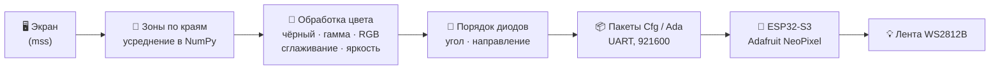

<div align="center">

# 🌈 Ambilight Advanced Hub

**Адаптивная подсветка монитора для ПК: приложение снимает цвета по краям экрана и в реальном времени отправляет их по USB на ESP32-S3, которая управляет лентой WS2812B.**

[](../../releases/latest)


[Возможности](#-возможности) •
[Как это работает](#-как-это-работает) •
[Быстрый старт](#-быстрый-старт) •
[Прошивка ESP32-S3](#-прошивка-esp32-s3) •
[Настройка](#-настройка) •
[Протокол](#-протокол-обмена-uart) •
[Диагностика](#-диагностика)

</div>

---

<!--
📸 Добавьте скриншоты в папку docs/screenshots и раскомментируйте блок ниже:

<div align="center">
  
  
</div>
-->

## 📖 О проекте

**Ambilight Advanced Hub** — система динамической подсветки для монитора. Приложение на ПК захватывает изображение с экрана, делит его краевые области на зоны (по одной зоне на каждый светодиод), усредняет цвет в каждой зоне, обрабатывает его (гамма, баланс каналов, отсечка чёрного, сглаживание, яркость) и отправляет готовый кадр по последовательному порту на **ESP32-S3**. Плата выводит цвета на адресную ленту **WS2812B** через библиотеку Adafruit NeoPixel.

Приложение работает из системного трея, применяет настройки без перезапуска, автоматически переподключается к плате и позволяет подробно настроить геометрию зон под любой монитор и любую длину ленты. Номер GPIO и количество диодов задаются прямо в приложении и передаются в ESP при каждом подключении — перепрошивать плату при изменении этих параметров не нужно.

Репозиторий содержит обе части системы:

| Часть | Где лежит | Назначение |
|---|---|---|
| 💻 **Приложение для ПК** | `Ambilight_8.py` · готовый `.exe` в [Releases](../../releases) | Захват экрана, расчёт и обработка цветов, отправка кадров, окно настроек и трей |
| 🔧 **Прошивка ESP32-S3** | `firmware/Ambilight_NeoPixel_1/Ambilight_NeoPixel_1.ino` | Приём кадров по UART, вывод на ленту, плавный розжиг и затухание |

## ✨ Возможности

| | |
|---|---|
| 📦 **Готовый exe** | Для Windows в [Releases](../../releases) лежит собранное приложение — Python устанавливать не нужно |
| 🖥️ **Быстрый захват экрана** | Библиотека `mss`; вместо захвата каждой зоны отдельно снимается одна полоса на сторону, а средние цвета считаются векторно в NumPy |
| 📐 **Гибкая геометрия** | Три режима: полный периметр, только нижняя линия, П-образный (низ + лево + право) |
| 🎛️ **Тонкая настройка зон** | Для каждой стороны: количество диодов, глубина захвата, отступ от края экрана, боковые поля |
| 🎨 **Цветокоррекция** | Гамма, множители R / G / B, отсечка чёрного, мастер-яркость |
| 🌊 **Сглаживание** | По кольцу — смешивание цвета соседних диодов; по времени — настраиваемая задержка для плавных переходов цвета |
| 🔀 **Временной дизеринг** | Перенос остаточной ошибки между кадрами |
| 🧪 **Тестовые режимы** | Заливка всей ленты красным / зелёным / синим для проверки проводки |
| 👁️ **Экранная сетка** | Прозрачный оверлей поверх всех окон показывает зоны захвата и их текущие цвета |
| 📌 **Пин и длина ленты из приложения** | GPIO и количество диодов передаются в ESP при подключении — менять код при смене проводки или длины ленты не нужно |
| 🌅 **Плавный розжиг и затухание** | Прошивка плавно зажигает ленту при появлении связи и гасит её, когда кадры перестали приходить |
| 🔌 **Автопереподключение** | Если ESP пропала — приложение ждёт её и подключается заново; опционально закрывается по таймауту |
| 🗂️ **Системный трей** | Включение / выключение подсветки, яркость, открытие настроек, выход |
| 🔒 **Один экземпляр** | Повторный запуск не плодит копии, а открывает окно настроек уже запущенной |
| 💾 **Автосохранение** | Все параметры сохраняются в `ambilight_config.json` при каждом изменении |

## 🧠 Как это работает



Программа на ПК работает в двух потоках:

- **Главный поток (GUI)** — окно настроек, системный трей, экранный оверлей.
- **Рабочий поток `AmbilightWorker`** (`QThread`) — захват, расчёт цветов и отправка кадров. Он же следит за соединением и переподключается к порту.

### Захват и усреднение

1. Берётся первый монитор (`mss.monitors[1]`).
2. По настройкам считаются прямоугольники зон для каждого диода.
3. Соседние зоны одной стороны объединяются в **полосу** — на кадр выполняется не больше нескольких `grab()` вместо десятков.
4. Внутри полосы пиксели суммируются вдоль «глубины» зоны, а затем `np.add.reduceat` даёт сумму по каждой зоне — это и есть средний цвет.

### Конвейер обработки цвета

Порядок шагов в `process_colors()`:

1. **Тестовый режим** — если включён, возвращается сплошной цвет, остальные шаги пропускаются.
2. **Отсечка чёрного** — если максимальный канал зоны (0–255) ниже порога, диод гасится. Это не даёт тёмным и серым сценам светиться белёсым.
3. **Гамма** — `цвет = (значение / 255) ^ gamma`.
4. **Баланс каналов** — множители R, G, B, затем ограничение в диапазоне `0…1`.
5. **Сглаживание по кольцу** — `(1 − s)·текущий + (s / 2)·(предыдущий + следующий)`. Работает между *соседними диодами*, а не между кадрами.
6. **Мастер-яркость** — цвет масштабируется целиком (оттенок не меняется).
7. **Сглаживание по времени** — экспоненциальный фильтр между кадрами: `α = 16 / (задержка + 16)`, `цвет = α·новый + (1 − α)·предыдущий`. Значение `0` отключает фильтр. Формула рассчитана на шаг кадра около 16 мс (60 FPS). Чёрные зоны при включённом фильтре гаснут плавно.
8. **Временной дизеринг** — остаточная ошибка переносится на следующий кадр; для чёрных зон она обнуляется.
9. **Приведение к `uint8`** — значения ограничиваются диапазоном `0…255` и уходят на ESP.

## 🧰 Что понадобится

### Железо

- Плата **ESP32-S3**.
- Адресная светодиодная лента **WS2812B**.
- USB-кабель для соединения ПК с платой (виртуальный COM-порт).
- Отдельный блок питания 5 В, рассчитанный на ток вашей ленты. Не питайте длинную ленту через USB-порт платы.

### Софт

| Для чего | Что нужно |
|---|---|
| Приложение (готовый exe) | Windows 10 / 11 |
| Приложение (из исходников) | Windows 10 / 11, **Python 3.9+**, пакеты `numpy`, `mss`, `pyserial`, `PyQt6` |
| Прошивка | [Arduino IDE](https://www.arduino.cc/en/software), пакет плат **esp32** от Espressif, библиотека **Adafruit NeoPixel** |

> [!NOTE]
> Приложение рассчитано на Windows: значения по умолчанию (например, порт `COM12`) и отключение флага `CAPTUREBLT` в `mss` относятся к ней.

## 🚀 Быстрый старт

### 1. Соберите схему

Подключите ленту к плате по [схеме из раздела о прошивке](#подключение). По умолчанию вход данных ленты (`DIN`) подключается к **GPIO 4**.

### 2. Прошейте ESP32-S3

Откройте `Ambilight_NeoPixel.ino` в Arduino IDE, установите библиотеку **Adafruit NeoPixel** и загрузите скетч на плату. Пошаговая инструкция — в разделе [Прошивка ESP32-S3](#-прошивка-esp32-s3).

### 3. Запустите приложение

**Вариант А — готовый exe (рекомендуется)**

1. Скачайте `.exe` из [последнего релиза](../../releases/latest).
2. Запустите файл. Python и зависимости не нужны.

> [!NOTE]
> Windows SmartScreen или антивирус могут показать предупреждение: это типично для неподписанных exe-файлов, собранных из Python-скриптов.

**Вариант Б — из исходников**

```bash
# 1. Клонируйте репозиторий
git clone https://github.com/<ваш-логин>/<имя-репозитория>.git
cd <имя-репозитория>

# 2. (Рекомендуется) создайте виртуальное окружение
python -m venv .venv
.venv\Scripts\activate

# 3. Установите зависимости
pip install numpy mss pyserial PyQt6

# 4. Запустите
python Ambilight_8.py
```

### Что происходит при запуске

1. Окно настроек **не открывается** — приложение появляется в системном трее и сразу начинает подсвечивать. Клик по значку открывает окно.
2. По умолчанию используется порт `COM12` и скорость `921600`. Если плата на другом порту — выберите его в списке **«COM-порт»**; кнопка **«Обновить»** пересканирует порты.
3. На вкладке **«Общие параметры»** укажите **пин ESP (GPIO)** и количество диодов на каждой стороне. Эти значения отправляются в ESP при каждом подключении.
4. Подберите геометрию зон (см. [Настройка](#-настройка)).

> [!TIP]
> Не знаете, какой у вас порт? Откройте «Диспетчер устройств» → «Порты (COM и LPT)».

## 🔧 Прошивка ESP32-S3

Скетч [`Ambilight_NeoPixel.ino`](Ambilight_NeoPixel.ino) принимает пакеты от приложения по UART и выводит цвета на ленту через библиотеку **Adafruit NeoPixel**.

### Параметры прошивки

| Параметр | Значение | Где задаётся | Описание |
|---|---|---|---|
| GPIO ленты | `4` по умолчанию | приложение (**Пин ESP**) | Пин, к которому подключён `DIN` ленты. Приложение присылает его при каждом подключении |
| Количество диодов | `60` по умолчанию | приложение | Передаётся в конфигурационном пакете; до его получения кадры не принимаются |
| `MAX_LEDS` | `500` | скетч | Максимальное общее число диодов |
| `TIMEOUT_MS` | `400` | скетч | Через сколько мс без кадров лента начнёт гаснуть |
| Скорость UART | `921600` | скетч (`Serial.begin`) | Должна совпадать с **Baud Rate** в приложении |
| Тип ленты | `NEO_GRB + NEO_KHZ800` | скетч | Порядок каналов GRB, 800 кГц — это WS2812B |

> [!IMPORTANT]
> Скорость в приложении (**Baud Rate**) должна оставаться равной `921600`: именно это значение зашито в прошивку.

### Прошивка платы

1. Установите [Arduino IDE](https://www.arduino.cc/en/software) и добавьте поддержку ESP32: **Boards Manager** → пакет *esp32* от Espressif Systems.
2. Установите библиотеку: **Library Manager** → *Adafruit NeoPixel*.
3. Откройте `Ambilight_NeoPixel_1.ino`. Arduino IDE требует, чтобы скетч лежал в папке с таким же именем: `Ambilight_NeoPixel_1/Ambilight_NeoPixel_1.ino`.
4. Выберите плату (**ESP32S3 Dev Module** или вашу конкретную) и порт.
5. Нажмите **Upload**.

> [!TIP]
> На ESP32-S3 объект `Serial` — это либо UART0, либо нативный USB (в зависимости от опции **USB CDC On Boot** в меню Tools). Подключайте кабель к тому USB-разъёму платы, который соответствует выбранной опции, и выбирайте в приложении именно этот COM-порт.

### Подключение

| Откуда | Куда |
|---|---|
| ESP32-S3 `GPIO 4` (через резистор ≈ 330 Ом) | `DIN` ленты |
| ESP32-S3 `GND` | `GND` ленты и `GND` блока питания (общая земля) |
| `+5 В` блока питания | `+5V` ленты |

Если вы подключили ленту к другому GPIO, просто укажите его номер в приложении — перепрошивать плату не нужно.

> [!TIP]
> Общие рекомендации для WS2812B: резистор 220–470 Ом в линии данных, конденсатор 470–1000 мкФ на питании ленты, отдельный блок питания 5 В под ток ленты. Если лента ведёт себя нестабильно от 3.3 В логики ESP32-S3, добавьте преобразователь уровня.

> [!WARNING]
> Выбирая GPIO, избегайте пинов, которые заняты у ESP32-S3 под служебные функции: strapping-пинов (0, 3, 45, 46), пинов USB (19, 20) и пинов флеш-памяти и PSRAM (26–32, а на модулях с octal PSRAM ещё и 33–37). Точный список зависит от модуля — сверяйтесь с распиновкой вашей платы.

### Как ведёт себя прошивка

- **Настройки не сохраняются в памяти платы.** После включения питания или перезагрузки прошивка использует значения по умолчанию (GPIO 4, 60 диодов), лента погашена, и плата ждёт конфигурационный пакет от приложения.
- **Кадры принимаются только после первого корректного конфигурационного пакета.** Приложение отправляет его при каждом подключении к порту и при изменении пина или числа диодов (см. [протокол](#-протокол-обмена-uart)).
- При изменении пина или количества диодов объект ленты создаётся заново.
- **Устойчивость к рассинхронизации.** Заголовок пакета ищется побайтово в скользящем окне из трёх байт, поэтому после сбоя или потери байта поток восстанавливается сам.
- Пакеты с неверной контрольной суммой отбрасываются; кадр принимается, только если пришли все его байты (в пределах 30 мс) и количество диодов в нём не превышает настроенное.
- Максимум — **500 диодов** (`MAX_LEDS`). Приложение позволяет задать до 300 на сторону, но суммарное значение выше 500 прошивка не примет.
- При появлении связи лента **плавно разгорается** до целевой яркости. Целевая яркость берётся из байта яркости в пакете: приложение всегда шлёт 255, поэтому регулировка яркости происходит на стороне ПК.
- Если корректные кадры не приходят дольше `TIMEOUT_MS` (ПК выключен, приложение закрыто, связь потеряна), лента **плавно гаснет**. Когда связь возвращается, розжиг повторяется.
- **Вывод в ленту только при изменениях.** `show()` вызывается, когда пришёл новый кадр или меняется яркость (розжиг, затухание), а не в каждом проходе цикла.

## 🎛️ Настройка

Окно настроек состоит из шести вкладок. Любое изменение **применяется сразу** и записывается в конфиг.

### Вкладка «Общие параметры»

| Параметр | Описание |
|---|---|
| **Режим использования периметра** | Полный периметр (4 стороны) · Только нижняя линия · П-образный (низ + лево + право) |
| **Пин ESP (GPIO)** | GPIO ленты на плате, 0–48. Отправляется в ESP и сохраняется там |
| **Диодов (Низ / Верх / Лево / Право)** | Число диодов на каждой стороне, 0–300; суммарно не больше 500 |
| **Baud Rate** | Скорость порта, 9600–2 000 000. Для этой прошивки — `921600` |
| **Лимит FPS** | Целевая частота кадров, 10–240; активен только при выключенной синхронизации |
| **Синхронизировать с частотой экрана** | Работа на потолке в 60 FPS (константа `SYNC_MAX_FPS`) |
| **Таймаут подключения** | Сколько секунд ждать ESP, 5–300 |
| **Закрывать приложение при таймауте** | Завершить программу, если связь не удалось установить за отведённое время |
| **Угол подключения ленты** | Угол экрана, с которого начинается лента |
| **Направление обхода** | По часовой / против часовой |
| **Тестовый режим** | `Disabled` · `Red` · `Green` · `Blue` |

### Вкладка «Цвет и Гамма»

| Параметр | Диапазон | Назначение |
|---|---|---|
| **Мастер Яркость** | 0–100 % | Общая яркость; цвета не меняются, только уровень |
| **Гамма** | 0.5–4.0 | Нелинейность отклика ленты |
| **Отсечка чёрного** | 0–100 | Зоны темнее порога гасятся (при включённой задержке — плавно) |
| **Задержка сглаживания** | 0–1000 мс, шаг 25 | Плавность переходов цвета во времени: чем больше значение, тем медленнее цвет догоняет картинку; `0` — без задержки |
| **Красный / Зелёный / Синий** | 0.0–2.0 | Баланс белого, шаг 0.05 |
| **Сглаживание по кольцу** | 0.0–1.0 | Смешивание с соседними диодами |
| **Временной дизеринг** | вкл / выкл | Перенос остаточной ошибки между кадрами |

### Вкладки «Нижняя / Верхняя / Левая / Правая зона»

Для каждой стороны задаются три размера в пикселях:

| Параметр | Диапазон | Смысл |
|---|---|---|
| **Высота / ширина зоны захвата** | 5–300 | Насколько глубоко от края экрана усредняются цвета |
| **Отступ от края экрана** | 0–300 | Сдвиг зоны внутрь экрана |
| **Отступ по бокам** | 0–1000 | Сколько пикселей вдоль стороны пропустить с обоих концов |

Вкладки неиспользуемых сторон автоматически блокируются в зависимости от выбранного режима периметра.

```
          Отступ по бокам                    Отступ по бокам
          ◄────────►                         ◄────────►
   ┌──────┬──────────────────────────────────┬──────┐  ─┐
   │      │  ▒▒▒▒▒▒▒▒▒  ВЕРХНЯЯ  ▒▒▒▒▒▒▒▒▒   │      │   │ Высота зоны
   ├──────┘                                  └──────┤  ─┘
   │▒                                              ▒│
   │▒ ЛЕВАЯ                              ПРАВАЯ    ▒│
   │▒                                              ▒│
   ├──────┐                                  ┌──────┤
   │      │  ▒▒▒▒▒▒▒▒▒  НИЖНЯЯ  ▒▒▒▒▒▒▒▒▒   │      │
   └──────┴──────────────────────────────────┴──────┘
```

### Как правильно настроить ленту — пошагово

1. Укажите **пин ESP (GPIO)** и число диодов на каждой стороне — по реальной ленте.
2. Включите **«Показать сетку на экране»** — на экране появятся прямоугольники зон, закрашенные текущими цветами диодов. Подберите глубину зон и отступы.
3. Включите **тестовый режим** `Red`, `Green`, `Blue` и убедитесь, что вся лента светится нужным цветом.
4. Если картинка на ленте *сдвинута или зеркальна* относительно экрана — подберите **«Угол подключения ленты»** и **«Направление обхода»**.
5. Отрегулируйте гамму, баланс каналов, отсечку чёрного и задержку сглаживания под ваш монитор и ленту.

> [!TIP]
> Если цвета на ленте идут в неправильном порядке каналов (например, красный вместо зелёного), порядок задаётся в прошивке флагом `NEO_GRB` в строках `new Adafruit_NeoPixel(...)` (их две). Приложение всегда отправляет байты в порядке R, G, B.

### Все параметры конфига

Файл `ambilight_config.json` создаётся автоматически в **текущей рабочей папке** при первом изменении настроек. Недостающие ключи подставляются из значений по умолчанию, так что файл можно безопасно редактировать вручную.

<details>
<summary><b>Показать полную таблицу значений по умолчанию</b></summary>

| Ключ | По умолчанию | Описание |
|---|---|---|
| `port` | `"COM12"` | COM-порт |
| `baudrate` | `921600` | Скорость порта |
| `pin` | `4` | GPIO ленты на ESP32-S3 |
| `target_fps` | `60` | Лимит FPS без синхронизации |
| `sync_with_screen` | `true` | Режим с потолком 60 FPS |
| `master_brightness` | `75` | Яркость, % |
| `gamma` | `1.9` | Гамма |
| `black_threshold` | `35` | Порог отсечки чёрного |
| `r_correction`, `g_correction`, `b_correction` | `1.0` | Баланс каналов |
| `smoothing` | `0.1` | Сглаживание по соседям |
| `transition_delay` | `75` | Задержка сглаживания по времени, мс (`0` — выкл.) |
| `enable_dithering` | `true` | Временной дизеринг |
| `connection_timeout` | `30` | Таймаут связи, сек (`0` — без таймаута) |
| `exit_on_timeout` | `true` | Закрывать приложение при таймауте |
| `layout_mode` | `"Полный периметр (4 стороны)"` | Режим периметра |
| `bottom_count` / `top_count` | `30` / `30` | Диодов снизу / сверху |
| `left_count` / `right_count` | `20` / `20` | Диодов слева / справа |
| `bottom_height` / `top_height` | `40` / `40` | Высота зон, px |
| `left_width` / `right_width` | `40` / `40` | Ширина зон, px |
| `bottom_offset`, `top_offset`, `left_offset`, `right_offset` | `5` | Отступ от края экрана, px |
| `bottom_margin_side`, `top_margin_side`, `left_margin_side`, `right_margin_side` | `0` | Боковые поля, px |
| `start_corner` | `"Нижний правый"` | Угол подключения ленты |
| `direction` | `0` | `0` — по часовой, `1` — против часовой |
| `test_mode` | `"Disabled"` | `Disabled` / `Red` / `Green` / `Blue` |

С параметрами по умолчанию получается **100 диодов** (30 + 30 + 20 + 20).

</details>

## 🗂️ Системный трей

Левый клик по значку открывает окно настроек. Контекстное меню:

| Пункт | Действие |
|---|---|
| **Выключить / Включить подсветку** | Гасит ленту и приостанавливает отправку кадров (захват продолжается) |
| **Яркость подсветки** | Ползунок и быстрые пресеты 0 / 25 / 50 / 75 / 100 % |
| **Открыть настройки** | Показывает окно настроек |
| **Выход** | Полностью закрывает приложение |

> [!NOTE]
> Сворачивание и закрытие окна (крестик) прячут его в трей — подсветка продолжает работать. Полностью завершить приложение можно только пунктом **«Выход»** в меню трея.

## 🔌 Протокол обмена (UART)

Приложение использует Adalight-подобный протокол с расширениями: добавлены байт яркости и служебный конфигурационный пакет с номером пина. Параметры порта: 8N1, скорость — `921600`.

### Конфигурационный пакет (8 байт)

| Байты | Значение |
|---|---|
| 0–2 | Заголовок `C` `f` `g` |
| 3 | `hi` — старший байт количества диодов |
| 4 | `lo` — младший байт количества диодов |
| 5 | `pin` — номер GPIO ленты |
| 6 | Яркость (всегда `255`) |
| 7 | Контрольная сумма: `hi ^ lo ^ pin ^ brightness ^ 0x33` |

Конфигурационный пакет отправляется **перед каждым кадром в течение 2 секунд** после подключения к порту, после старта приложения и после изменения количества диодов или пина. Повторная отправка нужна, чтобы плата гарантированно его приняла. Дальше уходят только кадры. Значения хранятся в ОЗУ платы: после её перезагрузки конфигурационный пакет нужно получить заново, а кадры до этого игнорируются.

### Пакет кадра

| Байты | Значение |
|---|---|
| 0–2 | Заголовок `A` `d` `a` |
| 3 | `hi` — старший байт количества диодов |
| 4 | `lo` — младший байт количества диодов |
| 5 | Яркость (в рабочих кадрах — `255`) |
| 6 | Контрольная сумма: `hi ^ lo ^ brightness ^ 0x55` |
| 7 … | `N × 3` байт цвета: `R, G, B` для каждого диода |

> [!NOTE]
> В отличие от классического Adalight, в `hi/lo` передаётся **само количество диодов**, а не `N − 1`. Яркость внутри кадра всегда 255 — настоящая яркость уже применена к цветам на стороне ПК.

При выключении подсветки из трея отправляется один «погашающий» кадр: все цвета нулевые, байт яркости равен `0`, контрольная сумма считается по тому же правилу. Прошивка принимает ненулевое значение яркости как целевое, а нулевое игнорирует, поэтому такой кадр просто выводит чёрный цвет и не сбрасывает яркость.

### Пропускная способность

Размер кадра: `7 + 3·N` байт. При 8N1 на один байт уходит 10 бит, поэтому теоретический максимум кадров в секунду по UART:

```
FPS ≈ baudrate / 10 / (7 + 3·N)
```

| Диодов | Размер кадра | Теор. максимум при 921 600 бод |
|---|---|---|
| 100 | 307 байт | ≈ 300 FPS |
| 300 | 907 байт | ≈ 100 FPS |
| 500 | 1507 байт | ≈ 61 FPS |

Само приложение ограничивает частоту кадров: до 60 FPS в режиме синхронизации или значением «Лимит FPS». Дополнительно скорость ограничивает сама лента: на каждый диод WS2812B уходит порядка 30 мкс.

## ⚙️ Автозапуск и сборка

### Автозапуск с Windows

1. Нажмите `Win + R`, введите `shell:startup`.
2. Создайте в открывшейся папке ярлык:
   - **для exe** — на скачанный `.exe`;
   - **для исходников** — на `pythonw.exe` (запуск без консоли) с аргументом — полным путём к `Ambilight_8.py`.
3. В поле **«Рабочая папка»** ярлыка укажите папку с приложением — иначе `ambilight_config.json` будет создаваться и искаться в другом месте.

Если включён **«Закрывать приложение при таймауте»**, то при автозапуске без подключённой ESP приложение само завершится через заданное время.

### Самостоятельная сборка exe (по желанию)

```bash
pip install pyinstaller
pyinstaller --noconsole --onefile Ambilight_8.py
```

Готовый файл появится в папке `dist/`.

## 🩺 Диагностика

| Проблема | Что проверить |
|---|---|
| Статус «Ожидание ESP (COMx)…» | Верный ли выбран порт; подключена ли плата тем USB-разъёмом, который соответствует настройке `Serial` (см. подсказку в разделе о прошивке); не занят ли порт другой программой (монитор порта Arduino IDE и т. п.) |
| Приложение закрылось само | Сработал таймаут связи. Увеличьте его или отключите «Закрывать приложение при таймауте» |
| Лента не светится, но статус «Подключено» | Равен ли **Baud Rate** `921600`; совпадает ли **Пин ESP** с реальной проводкой; объединены ли земли платы, ленты и блока питания; подано ли питание на ленту; включена ли подсветка в трее; не превышает ли суммарное число диодов 500 |
| Лента не оживает после перезагрузки, перепрошивки или повторного включения питания платы, пока приложение работает | Плата не хранит настройки и принимает кадры только после конфигурационного пакета, а приложение шлёт его лишь 2 секунды после подключения к порту. Нажмите «СТОП ПОДСВЕТКИ», затем «СТАРТ ПОДСВЕТКИ» либо перезапустите приложение |
| Цвета не те (красный ↔ зелёный) | Измените `NEO_GRB` в прошивке (две строки с `new Adafruit_NeoPixel`) и перепрошейте плату; приложение всегда отправляет R, G, B |
| Мерцание, случайные пиксели | Общая земля; резистор в линии данных; преобразователь уровня 3.3 → 5 В; достаточное питание ленты |
| Эффект сдвинут или отзеркален | Подберите «Угол подключения ленты» и «Направление обхода», сверяясь с тестовыми режимами и экранной сеткой |
| Лента плавно гаснет вскоре после остановки приложения | Так и задумано: если кадры не приходят дольше `TIMEOUT_MS` (400 мс), прошивка гасит ленту |
| Тёмные сцены светятся белёсым | Увеличьте «Отсечку чёрного» или уменьшите яркость |
| Слишком контрастно или тускло | Поправьте «Гамму» |
| Цвет слишком медленно «догоняет» картинку или дёргается при смене сцен | Подберите «Задержку сглаживания»: меньше — быстрее реакция, больше — плавнее переходы |
| Низкий FPS | Уменьшите число диодов, сократите глубину зон захвата |
| Сетка на экране не там, где нужно | Оверлей рисуется по размерам основного экрана; захват берёт первый монитор (`mss.monitors[1]`) |

## ⚠️ Ограничения

- Захватывается **только первый монитор**.
- Захват основан на GDI (через `mss`): он может не работать в эксклюзивном полноэкранном режиме и с защищённым (DRM) видео. В таких случаях используйте режим окна без рамки (borderless).
- Приложение рассчитано на Windows; на других ОС не тестировалось.
- Прошивка рассчитана на одну ленту на одном пине и не более 500 диодов суммарно.
- Пин и число диодов не хранятся в памяти платы: после её перезагрузки их заново присылает приложение.
- Прошивка настроена на ленты WS2812B (GRB, 800 кГц). Для других типов измените флаги в `new Adafruit_NeoPixel(...)`.

## 📁 Структура репозитория

```
.
├── Ambilight_8.py                     # Приложение для ПК: GUI, захват, обработка, UART
├── ambilight_config.json              # Создаётся автоматически при первом изменении настроек
├── Ambilight_NeoPixel.ino           # Прошивка ESP32-S3 (папка называется так же, как скетч)
└── README.md
```

Готовый `.exe` приложения распространяется через раздел [Releases](../../releases).

Основные части кода `Ambilight_8.py`:

| Компонент | Роль |
|---|---|
| `AmbilightWorker` | Рабочий поток: захват, обработка, отправка, переподключение |
| `process_colors()` | Конвейер цветокоррекции |
| `generate_zones_rects()` | Расчёт прямоугольников зон под выбранный режим |
| `reorder_leds()` | Приведение порядка диодов к физическому порядку ленты |
| `send_adalight_data()` | Формирование и отправка пакетов `Cfg` и `Ada` |
| `ConfigOverlay` | Прозрачный оверлей с сеткой зон |
| `MainWindow` | Окно настроек с вкладками |
| `TrayApp` | Иконка и меню в системном трее |

Прошивка `Ambilight_NeoPixel.ino` — один файл: `setup()` создаёт ленту с параметрами по умолчанию, а `loop()` побайтово ищет заголовки пакетов `Cfg` и `Ada`, управляет яркостью и выводит кадр в ленту.

## 🤝 Вклад в проект

Идеи, баг-репорты и pull request'ы приветствуются:

1. Сделайте форк репозитория.
2. Создайте ветку: `git checkout -b feature/my-feature`.
3. Закоммитьте изменения и отправьте ветку.
4. Откройте Pull Request.

## 📄 Лицензия

Проект распространяется по лицензии **MIT**. Добавьте файл `LICENSE` в корень репозитория или замените лицензию на нужную.

---

<div align="center">

Сделано с 💡 для комфортных вечеров перед экраном

</div>
