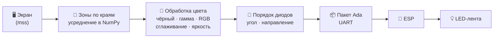

<div align="center">

# 🌈 Ambilight Advanced Hub

**Адаптивная подсветка монитора для ПК: приложение снимает цвета по краям экрана и в реальном времени отправляет их на светодиодную ленту через UART.**


[Возможности](#-возможности) •
[Как это работает](#-как-это-работает) •
[Быстрый старт](#-быстрый-старт) •
[Настройка](#-настройка) •
[Протокол](#-протокол-обмена-uart) •
[Диагностика](#-диагностика)

</div>

---

<!--
📸 Добавьте скриншоты в папку docs/screenshots и раскомментируйте блок ниже:

<div align="center">
  
  
</div>
-->

## 📖 О проекте

**Ambilight Advanced Hub** — десктопное приложение на Python и PyQt6. Оно захватывает изображение с экрана, делит его краевые области на зоны (по одной зоне на каждый светодиод), усредняет цвет в каждой зоне, обрабатывает его (гамма, баланс каналов, отсечка чёрного, сглаживание, яркость) и отправляет готовый кадр по последовательному порту на микроконтроллер **ESP**, который управляет адресной светодиодной лентой.

Приложение работает из системного трея, поддерживает горячую смену настроек без перезапуска, автоматически переподключается к устройству и позволяет подробно настроить геометрию зон под любой монитор и любую длину ленты.

## ✨ Возможности

| | |
|---|---|
| 🖥️ **Быстрый захват экрана** | Библиотека `mss`; вместо захвата каждой зоны отдельно снимается одна полоса на сторону, а средние цвета считаются векторно в NumPy |
| 📐 **Гибкая геометрия** | Три режима: полный периметр, только нижняя линия, П-образный (низ + лево + право) |
| 🎛️ **Тонкая настройка зон** | Для каждой стороны: количество диодов, глубина захвата, отступ от края экрана, боковые поля |
| 🎨 **Цветокоррекция** | Гамма, множители R / G / B, отсечка чёрного, мастер-яркость |
| 🌊 **Сглаживание** | Смешивание цвета соседних диодов по кольцу ленты |
| 🔀 **Временной дизеринг** | Перенос остаточной ошибки между кадрами |
| 🧪 **Тестовые режимы** | Заливка всей ленты красным / зелёным / синим для проверки проводки |
| 👁️ **Экранная сетка** | Прозрачный оверлей поверх всех окон показывает зоны захвата и их текущие цвета |
| 🔌 **Автопереподключение** | Если ESP пропала — приложение ждёт её и подключается заново; опционально закрывается по таймауту |
| 🗂️ **Системный трей** | Включение / выключение подсветки, яркость, открытие настроек, выход |
| 🔒 **Один экземпляр** | Повторный запуск не плодит копии, а просто открывает окно настроек уже запущенной |
| 💾 **Автосохранение** | Все параметры сохраняются в `ambilight_config.json` при каждом изменении |

## 🧠 Как это работает



Приложение состоит из двух частей:

- **Главный поток (GUI)** — окно настроек, системный трей, экранный оверлей.
- **Рабочий поток `AmbilightWorker`** (`QThread`) — захват, расчёт цветов и отправка кадров. Он же следит за соединением и переподключается к порту.

### Захват и усреднение

1. Берётся первый монитор (`mss.monitors[1]`).
2. По настройкам считаются прямоугольники зон для каждого диода.
3. Соседние зоны одной стороны объединяются в **полосу** — на кадр выполняется не больше нескольких `grab()` вместо десятков.
4. Внутри полосы пиксели суммируются вдоль «глубины» зоны, а затем `np.add.reduceat` даёт сумму по каждой зоне — это и есть средний цвет.

### Конвейер обработки цвета

Порядок шагов в `process_colors()`:

1. **Тестовый режим** — если включён, возвращается сплошной цвет, остальные шаги пропускаются.
2. **Отсечка чёрного** — если максимальный канал зоны (0–255) ниже порога, диод гасится. Это не даёт тёмным и серым сценам светиться белёсым.
3. **Гамма** — `цвет = (значение / 255) ^ gamma`.
4. **Баланс каналов** — множители R, G, B, затем ограничение в диапазоне `0…1`.
5. **Сглаживание по кольцу** — `(1 − s)·текущий + (s / 2)·(предыдущий + следующий)`. Работает между *соседними диодами*, а не между кадрами.
6. **Временной дизеринг** — остаточная ошибка переносится на следующий кадр.
7. **Мастер-яркость** — цвет масштабируется целиком (оттенок не меняется), затем приводится к `uint8`. Чёрные зоны остаются строго нулевыми.

## 🧰 Что понадобится

### Железо

- Адресная RGB-светодиодная лента (тип зависит от вашей прошивки, например WS2812B).
- Плата на базе **ESP** с прошивкой, понимающей [протокол обмена](#-протокол-обмена-uart) этого приложения.
- USB-кабель (виртуальный COM-порт) для соединения ПК с ESP.
- Отдельное питание ленты достаточной мощности — не питайте длинную ленту через USB-порт платы.

> [!NOTE]
> Прошивка для ESP в этот репозиторий не входит. Если у вас есть свой скетч или проект — добавьте на него ссылку в этот раздел.

### Софт

- **Windows 10 / 11** — основная платформа (значения по умолчанию, например `COM12`, и отключение `CAPTUREBLT` рассчитаны на неё).
- **Python 3.9+**
- Зависимости: `numpy`, `mss`, `pyserial`, `PyQt6`

## 🚀 Быстрый старт

```bash
# 1. Клонируйте репозиторий
git clone https://github.com/<ваш-логин>/<имя-репозитория>.git
cd <имя-репозитория>

# 2. (Рекомендуется) создайте виртуальное окружение
python -m venv .venv
.venv\Scripts\activate

# 3. Установите зависимости
pip install numpy mss pyserial PyQt6

# 4. Запустите
python Ambilight6.py
```

Что происходит при запуске:

1. Окно настроек **не открывается** — приложение появляется в системном трее и сразу начинает подсвечивать.
2. По умолчанию используется порт `COM12` и скорость `921600`. Если ваша плата на другом порту — откройте настройки (клик по значку в трее) и выберите его в списке **«COM-порт»**. Кнопка **«Обновить»** пересканирует порты.
3. Задайте количество диодов на каждой стороне и проверьте геометрию (см. [Настройка](#-настройка)).

> [!TIP]
> Не знаете, какой у вас порт? Откройте «Диспетчер устройств» → «Порты (COM и LPT)».

## 🎛️ Настройка

Окно настроек состоит из шести вкладок. Любое изменение **применяется сразу** и записывается в конфиг.

### Вкладка «Общие параметры»

| Параметр | Описание |
|---|---|
| **Режим использования периметра** | Полный периметр (4 стороны) · Только нижняя линия · П-образный (низ + лево + право) |
| **Диодов (Низ / Верх / Лево / Право)** | Число диодов на каждой стороне, 0–300 |
| **Baud Rate** | Скорость порта, 9600–2 000 000 (по умолчанию 921600; должна совпадать с прошивкой) |
| **Лимит FPS** | Целевая частота кадров, 10–240; активен только при выключенной синхронизации |
| **Синхронизировать с частотой экрана** | Работа на потолке в 60 FPS (константа `SYNC_MAX_FPS`) |
| **Таймаут подключения** | Сколько секунд ждать ESP, 5–300 |
| **Закрывать приложение при таймауте** | Завершить программу, если связь не удалось установить за отведённое время |
| **Угол подключения ленты** | Угол экрана, с которого начинается лента |
| **Направление обхода** | По часовой / против часовой |
| **Тестовый режим** | `Disabled` · `Red` · `Green` · `Blue` |

### Вкладка «Цвет и Гамма»

| Параметр | Диапазон | Назначение |
|---|---|---|
| **Мастер Яркость** | 0–100 % | Общая яркость; цвета не меняются, только уровень |
| **Гамма** | 0.5–4.0 | Нелинейность отклика ленты |
| **Отсечка чёрного** | 0–100 | Зоны темнее порога полностью гасятся |
| **Красный / Зелёный / Синий** | 0.0–2.0 | Баланс белого, шаг 0.05 |
| **Сглаживание по кольцу** | 0.0–1.0 | Смешивание с соседними диодами |
| **Временной дизеринг** | вкл / выкл | Перенос остаточной ошибки между кадрами |

### Вкладки «Нижняя / Верхняя / Левая / Правая зона»

Для каждой стороны задаются три размера в пикселях:

| Параметр | Диапазон | Смысл |
|---|---|---|
| **Высота / ширина зоны захвата** | 5–300 | Насколько глубоко от края экрана усредняются цвета |
| **Отступ от края экрана** | 0–300 | Сдвиг зоны внутрь экрана |
| **Отступ по бокам** | 0–1000 | Сколько пикселей вдоль стороны пропустить с обоих концов |

Вкладки неиспользуемых сторон автоматически блокируются в зависимости от выбранного режима периметра.

```
          Отступ по бокам                    Отступ по бокам
          ◄────────►                         ◄────────►
   ┌──────┬──────────────────────────────────┬──────┐  ─┐
   │      │  ▒▒▒▒▒▒▒▒▒  ВЕРХНЯЯ  ▒▒▒▒▒▒▒▒▒   │      │   │ Высота зоны
   ├──────┘                                  └──────┤  ─┘
   │▒                                              ▒│
   │▒ ЛЕВАЯ                              ПРАВАЯ    ▒│
   │▒                                              ▒│
   ├──────┐                                  ┌──────┤
   │      │  ▒▒▒▒▒▒▒▒▒  НИЖНЯЯ  ▒▒▒▒▒▒▒▒▒   │      │
   └──────┴──────────────────────────────────┴──────┘
```

### Как правильно настроить ленту — пошагово

1. Укажите число диодов на каждой стороне — по реальной ленте.
2. Включите **«Показать сетку на экране»** — на экране появятся прямоугольники зон, закрашенные текущими цветами диодов. Подберите глубину зон и отступы.
3. Включите **тестовый режим** `Red`, `Green`, `Blue` и убедитесь, что вся лента светится нужным цветом.
4. Если картинка на ленте *сдвинута или зеркальна* относительно экрана — подберите **«Угол подключения ленты»** и **«Направление обхода»**.
5. Отрегулируйте гамму, баланс каналов и отсечку чёрного под ваш монитор и ленту.

> [!TIP]
> Если цвета на ленте идут в неправильном порядке каналов (например, красный вместо зелёного), это настраивается в прошивке ESP: приложение всегда отправляет байты в порядке R, G, B.

### Все параметры конфига

Файл `ambilight_config.json` создаётся автоматически в **текущей рабочей папке** при первом изменении настроек. Недостающие ключи подставляются из значений по умолчанию, так что файл можно безопасно редактировать вручную.

<details>
<summary><b>Показать полную таблицу значений по умолчанию</b></summary>

| Ключ | По умолчанию | Описание |
|---|---|---|
| `port` | `"COM12"` | COM-порт |
| `baudrate` | `921600` | Скорость порта |
| `target_fps` | `60` | Лимит FPS без синхронизации |
| `sync_with_screen` | `true` | Режим с потолком 60 FPS |
| `master_brightness` | `75` | Яркость, % |
| `gamma` | `1.9` | Гамма |
| `black_threshold` | `35` | Порог отсечки чёрного |
| `r_correction`, `g_correction`, `b_correction` | `1.0` | Баланс каналов |
| `smoothing` | `0.1` | Сглаживание по соседям |
| `enable_dithering` | `true` | Временной дизеринг |
| `connection_timeout` | `30` | Таймаут связи, сек (`0` — без таймаута) |
| `exit_on_timeout` | `true` | Закрывать приложение при таймауте |
| `layout_mode` | `"Полный периметр (4 стороны)"` | Режим периметра |
| `bottom_count` / `top_count` | `30` / `30` | Диодов снизу / сверху |
| `left_count` / `right_count` | `20` / `20` | Диодов слева / справа |
| `bottom_height` / `top_height` | `40` / `40` | Высота зон, px |
| `left_width` / `right_width` | `40` / `40` | Ширина зон, px |
| `bottom_offset`, `top_offset`, `left_offset`, `right_offset` | `5` | Отступ от края экрана, px |
| `bottom_margin_side`, `top_margin_side`, `left_margin_side`, `right_margin_side` | `0` | Боковые поля, px |
| `start_corner` | `"Нижний правый"` | Угол подключения ленты |
| `direction` | `0` | `0` — по часовой, `1` — против часовой |
| `test_mode` | `"Disabled"` | `Disabled` / `Red` / `Green` / `Blue` |

С параметрами по умолчанию получается **100 диодов** (30 + 30 + 20 + 20).

</details>

## 🗂️ Системный трей

Левый клик по значку открывает окно настроек. Контекстное меню:

| Пункт | Действие |
|---|---|
| **Выключить / Включить подсветку** | Гасит ленту и приостанавливает отправку кадров (захват продолжается) |
| **Яркость подсветки** | Ползунок и быстрые пресеты 0 / 25 / 50 / 75 / 100 % |
| **Открыть настройки** | Показывает окно настроек |
| **Выход** | Полностью закрывает приложение |

> [!IMPORTANT]
> Сворачивание окна прячет его в трей, но **закрытие окна крестиком завершает приложение**. Чтобы оставить подсветку работать, сворачивайте окно, а не закрывайте.

## 🔌 Протокол обмена (UART)

Приложение использует Adalight-подобный протокол с расширением: добавлены байт яркости и служебный конфигурационный пакет. Параметры порта: 8N1, скорость задаётся в настройках.

### Конфигурационный пакет

Отправляется один раз после подключения и каждый раз, когда меняется общее количество диодов.

| Байты | Значение |
|---|---|
| 0–2 | Заголовок `C` `f` `g` |
| 3 | `hi` — старший байт количества диодов |
| 4 | `lo` — младший байт количества диодов |
| 5 | Яркость (всегда `255`) |
| 6 | Контрольная сумма: `hi ^ lo ^ brightness ^ 0x33` |

### Пакет кадра

| Байты | Значение |
|---|---|
| 0–2 | Заголовок `A` `d` `a` |
| 3 | `hi` — старший байт количества диодов |
| 4 | `lo` — младший байт количества диодов |
| 5 | Яркость (в рабочих кадрах — `255`) |
| 6 | Контрольная сумма: `hi ^ lo ^ brightness ^ 0x55` |
| 7 … | `N × 3` байт цвета: `R, G, B` для каждого диода |

> [!NOTE]
> В отличие от классического Adalight, в `hi/lo` передаётся **само количество диодов**, а не `N − 1`. Яркость внутри кадра всегда 255 — настоящая яркость уже применена к цветам на стороне ПК.

При выключении подсветки из трея отправляется один «погашающий» кадр: все цвета нулевые, байт яркости равен `0`, контрольная сумма считается по тому же правилу.

### Пропускная способность

Размер кадра: `7 + 3·N` байт. При 8N1 на один байт уходит 10 бит, поэтому теоретический максимум кадров в секунду:

```
FPS ≈ baudrate / 10 / (7 + 3·N)
```

| Диодов | Размер кадра | Теор. максимум при 921 600 бод |
|---|---|---|
| 100 | 307 байт | ≈ 300 FPS |
| 300 | 907 байт | ≈ 100 FPS |
| 1200 | 3607 байт | ≈ 25 FPS |

Само приложение ограничивает частоту кадров: до 60 FPS в режиме синхронизации или значением «Лимит FPS».

## ⚙️ Автозапуск и сборка

### Автозапуск с Windows

1. Нажмите `Win + R`, введите `shell:startup`.
2. Создайте в открывшейся папке ярлык на `pythonw.exe` (запуск без консоли) с аргументом — полным путём к `Ambilight6.py`.
3. В поле **«Рабочая папка»** ярлыка укажите папку проекта — иначе `ambilight_config.json` будет создаваться и искаться в другом месте.

Если включён **«Закрывать приложение при таймауте»**, то при автозапуске без подключённой ESP приложение само завершится через заданное время.

### Сборка в один `.exe` (по желанию)

```bash
pip install pyinstaller
pyinstaller --noconsole --onefile Ambilight6.py
```

Готовый файл появится в папке `dist/`.

## 🩺 Диагностика

| Проблема | Что проверить |
|---|---|
| Статус «Ожидание ESP (COMx)…» | Верный ли выбран порт; подключена ли плата; не занят ли порт другой программой (монитор порта Arduino IDE и т. п.) |
| Приложение закрылось само | Сработал таймаут связи. Увеличьте его или отключите «Закрывать приложение при таймауте» |
| Лента не светится, но статус «Подключено» | Совпадает ли Baud Rate с прошивкой; обрабатывает ли прошивка пакеты `Cfg` и `Ada`; включена ли подсветка в трее |
| Цвета не те (красный ↔ зелёный) | Порядок каналов задаётся в прошивке; приложение отправляет R, G, B |
| Эффект сдвинут или отзеркален | Подберите «Угол подключения ленты» и «Направление обхода», сверяясь с тестовыми режимами и экранной сеткой |
| Тёмные сцены светятся белёсым | Увеличьте «Отсечку чёрного» или уменьшите яркость |
| Слишком контрастно или тускло | Поправьте «Гамму» |
| Низкий FPS | Уменьшите число диодов, увеличьте Baud Rate, сократите глубину зон захвата |
| Сетка на экране не там, где нужно | Оверлей рисуется по размерам основного экрана; захват берёт первый монитор (`mss.monitors[1]`) |
| Нет сетки в играх | Включённый поверх полноэкранных игр оверлей зависит от режима отображения игры — используйте оконный режим без рамки |

## ⚠️ Ограничения

- Захватывается **только первый монитор**.
- Захват основан на GDI (через `mss`): он может не работать в эксклюзивном полноэкранном режиме и с защищённым (DRM) видео. В таких случаях используйте режим окна без рамки (borderless).
- Приложение рассчитано на Windows; на других ОС не тестировалось.
- Прошивка для ESP не входит в репозиторий.

## 📁 Структура репозитория

```
.
├── Ambilight6.py              # Приложение целиком: GUI, захват, обработка, UART
├── ambilight_config.json      # Создаётся автоматически при первом изменении настроек
└── README.md
```

Основные части кода `Ambilight6.py`:

| Компонент | Роль |
|---|---|
| `AmbilightWorker` | Рабочий поток: захват, обработка, отправка, переподключение |
| `process_colors()` | Конвейер цветокоррекции |
| `generate_zones_rects()` | Расчёт прямоугольников зон под выбранный режим |
| `reorder_leds()` | Приведение порядка диодов к физическому порядку ленты |
| `send_adalight_data()` | Формирование и отправка пакетов `Cfg` и `Ada` |
| `ConfigOverlay` | Прозрачный оверлей с сеткой зон |
| `MainWindow` | Окно настроек с вкладками |
| `TrayApp` | Иконка и меню в системном трее |

## 🤝 Вклад в проект

Идеи, баг-репорты и pull request'ы приветствуются:

1. Сделайте форк репозитория.
2. Создайте ветку: `git checkout -b feature/my-feature`.
3. Закоммитьте изменения и отправьте ветку.
4. Откройте Pull Request.

## 📄 Лицензия

Проект распространяется по лицензии **MIT**. Добавьте файл `LICENSE` в корень репозитория или замените лицензию на нужную.

---

<div align="center">

Сделано с 💡 для комфортных вечеров перед экраном

</div>
